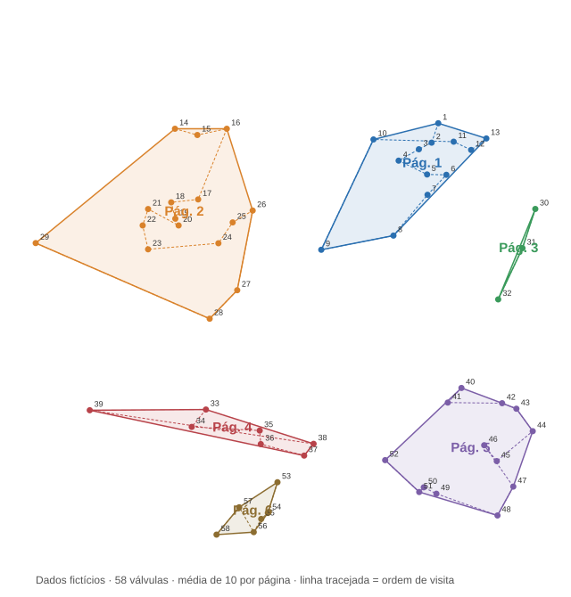
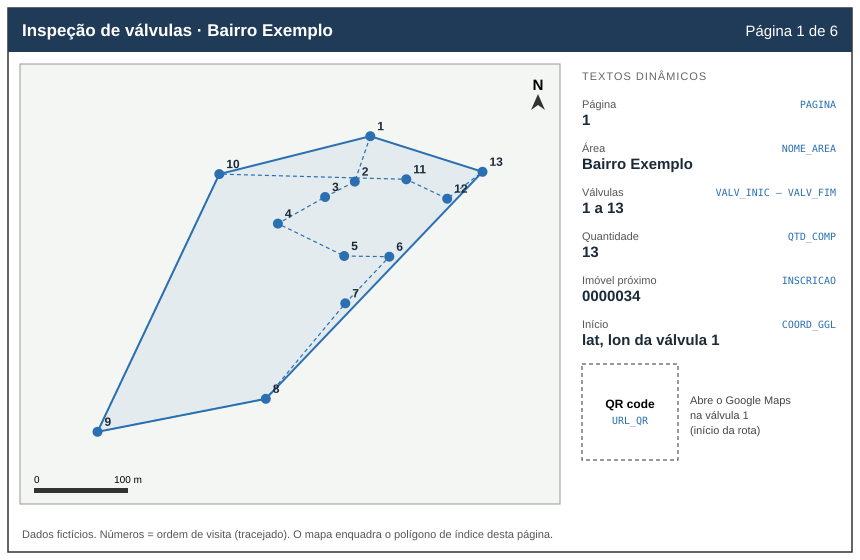

# Mapas e relatórios automatizados

Ferramentas em Python que transformam trabalho manual recorrente em saída pronta:

1. **Gerador de Área de Inspeção** (`inspecao/`): agrupa válvulas por proximidade, define a ordem de visita e cria os polígonos de índice de um Map Series de inspeção de campo, com coordenada e QR code para o Google Maps em cada página.
2. **Relatório mensal de Ordens de Serviço** (`relatorio_os/`): gera um Excel de gestão a partir da exportação de OS. *(código a publicar)*

> Adaptado de ferramentas que desenvolvi e uso no trabalho. **Todos os dados de exemplo são fictícios.**



*58 válvulas fictícias agrupadas em 6 páginas (média de 10 por página). Polígono = área de índice do Map Series; tracejado = ordem de visita; número = sequência da válvula.*

---

## 1. Gerador de Área de Inspeção

### O que é o Map Series e como a ferramenta o usa
O **Map Series** do ArcGIS Pro gera um caderno de mapas a partir de um único layout. Ele usa uma **camada de índice**: cada polígono dessa camada vira uma página. Em cada página, o mapa enquadra aquele polígono, e os **textos dinâmicos** do layout leem os campos da linha correspondente (número da página, nome da área etc.).

A ferramenta não desenha mapas. Ela **produz a camada de índice**:
- um polígono por página, que é o convex hull das válvulas do grupo;
- os campos que alimentam o layout: `PAGINA`, `NOME_AREA`, `VALV_INIC`/`VALV_FIM`, `QTD_COMP`, `INSCRICAO`, `COORD_GGL` e `URL_QR` (este último para uma imagem dinâmica de QR code);
- nas válvulas, o número de visita (`SEQ_VALV`) e a página (`PAGINA_MS`), usados nos rótulos do mapa.



**Por que uma camada consolidada:** cada execução **acrescenta** páginas às mesmas camadas mestre, continuando a numeração. Como essas camadas ficam num banco de dados compartilhado, um único Map Series cobre todas as áreas já processadas. Assim a equipe salva tudo num lugar só e exporta todas as folhas de uma vez, em lote, para PDF, em vez de manter um projeto ou arquivo por bairro.

### O problema
Uma grade retangular fixa no Map Series corta ruas e vizinhanças ao meio: válvulas a poucos metros uma da outra caem em folhas diferentes, e cada folha fica com uma quantidade muito diferente de pontos. Montar as áreas e a ordem de visita à mão é lento.

### Como funciona
1. **Agrupamento (K-Means):** o número de grupos é `total de válvulas ÷ média desejada por página`. Os pontos são agrupados pela distância real, então válvulas vizinhas ficam na mesma folha. A implementação é em Python puro e determinística: a mesma entrada gera as mesmas páginas.
2. **Ordem das páginas:** do grupo mais ao norte para o mais ao sul.
3. **Rota dentro da página:** começa na válvula mais ao norte e segue sempre para a vizinha mais próxima ainda não visitada. A numeração é contínua entre páginas.
4. **Polígono de índice:** o *convex hull* das válvulas de cada página. Com 1 ou 2 pontos, usa um retângulo com folga mínima.
5. **Consolidação:** em vez de criar um arquivo por bairro, acrescenta pontos e polígonos às camadas mestre existentes e continua a numeração das páginas (`MAX(PAGINA) + 1`). Assim fica um único Map Series para a cidade toda.
6. **Dados por página:**
   - válvula inicial e final;
   - coordenada da primeira válvula;
   - link do Google Maps em QR code;
   - inscrição do imóvel mais próximo;
   - opcionalmente, um atributo de uma camada de referência externa (ex.: lotes oficiais) num raio de 150 m.
7. **Camadas com Join:** a camada de referência é copiada para a memória antes do *Spatial Join*, porque camadas com Join ativo no ArcGIS Pro (campos `TABELA.CAMPO`) faziam a junção falhar.

O agrupamento e a rota ficam em `inspecao/agrupamento.py`, que a toolbox importa. Mantenha os dois arquivos na mesma pasta.

### Como rodar (ArcGIS Pro)
1. Importe os `.json` de `dados_exemplo/` com **JSON To Features**: área, válvulas e clientes.
2. Crie duas camadas vazias para receber o resultado, uma de pontos e uma de polígonos, no mesmo sistema de coordenadas. A ferramenta cria os campos que faltarem.
3. **Catalog** > **Add Toolbox** > `inspecao/GerenciadorInspecoes.pyt` > **Gerador de Área de Inspeção**.
4. No layout, configure o Map Series sobre a camada de polígonos, com `PAGINA` como número de página. Use `URL_QR` numa imagem dinâmica, se quiser o QR code impresso.

> **Privacidade:** o QR code é montado pelo serviço público `api.qrserver.com`, então a coordenada de cada página é enviada a esse serviço. Para dados sensíveis, gere o QR code localmente.

Fluxo, decisões técnicas, operação e backup: [docs/ARQUITETURA.md](docs/ARQUITETURA.md).

---

## 2. Relatório mensal de Ordens de Serviço *(código a publicar)*
Lê a exportação de OS e uma planilha de códigos de agrupamento e gera um Excel com as abas:
- Resumo Executivo
- Funil de Tempos
- Programação e Liderança
- Heatmap
- Não Executadas
- Desempenho por região
- Logística
- Qualidade de Dados

Inclui a revisão da regra de SLA: no cálculo original, uma OS não executada contava como "não atrasada".

---

## Tecnologias
- Python 3, arcpy e ArcGIS Pro (Map Series, Spatial Join, cursores `arcpy.da`)
- K-Means e roteirização por vizinho mais próximo, em Python puro
- QR code via URL (`api.qrserver.com`) e links do Google Maps

> **Requisito:** o `arcpy` **só funciona com o ArcGIS Pro instalado e licenciado**. Ele não se instala via `pip`.

## Estrutura de pastas
```
relatorios-mapas-automatizados/
├── inspecao/
│   ├── GerenciadorInspecoes.pyt   # toolbox do ArcGIS Pro
│   └── agrupamento.py             # K-Means + rota (Python puro)
├── dados_exemplo/
│   └── *_exemplo.json             # área, válvulas e clientes FICTÍCIOS
├── docs/
│   ├── ARQUITETURA.md             # fluxo, decisões, operação
│   ├── exemplo_inspecao.svg       # todas as páginas (dados fictícios)
│   └── exemplo_folha.svg          # uma folha do Map Series
├── requirements.txt
└── README.md
```

## Autor
Vitor Silva Garcia · [github.com/VitorGarciavsg](https://github.com/VitorGarciavsg) · vitorgarcia.vsg@gmail.com
