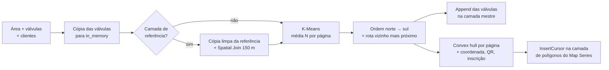

# Arquitetura: Gerador de Área de Inspeção

## Objetivo
Reduzir o trabalho manual e os erros na montagem de áreas e rotas de inspeção de válvulas em campo. A ferramenta agrupa os pontos, define a ordem de visita e consolida tudo em um único Map Series.

## Fluxo

## Decisões técnicas
| Decisão | Motivo |
|---|---|
| K-Means em vez de grade fixa | Válvulas vizinhas ficam na mesma página, e a quantidade por página fica próxima da média pedida |
| Centroides iniciais espalhados no eixo Y (sem aleatoriedade) | Mesma entrada, mesmas páginas: dá para reprocessar e comparar |
| Algoritmo em `agrupamento.py`, sem arcpy | Lógica de agrupamento separada da interface da toolbox, mais fácil de ler e ajustar |
| Append em camadas mestre + `MAX(PAGINA) + 1` | Um único Map Series para todas as áreas, sem arquivos soltos por bairro |
| Cópia da camada de referência para `in_memory` antes do Spatial Join | Camadas com Join ativo (campos `TABELA.CAMPO`) faziam a junção falhar |
| Retângulo com folga quando o convex hull não é polígono | Páginas com 1 ou 2 válvulas, ou com válvulas alinhadas, ainda geram área válida |
| Nomes de campo com até 10 caracteres | Compatível com shapefile, além de geodatabase |

## Requisitos
- ArcGIS Pro 3.x com `arcpy`. Não é instalável via pip.
- Camadas de entrada em sistema de coordenadas projetado (metros), recomendado.
- Acesso à internet só para **exibir** o QR code. A URL usa o serviço público `api.qrserver.com`, que recebe a coordenada da página.

## Operação
- **Mensagens:** progresso, avisos e erros aparecem no painel de geoprocessamento (`AddMessage`, `AddWarning`, `AddError`) e ficam no histórico de geoprocessamento do projeto.
- **Backup:** como a ferramenta **acrescenta** dados às camadas mestre, faça uma cópia, snapshot ou versão dessas camadas antes de cada lote. Assim um processamento repetido por engano pode ser desfeito.
- **Reprocessar uma área:** apague os pontos e polígonos dessa área nas camadas mestre antes de rodar de novo. Senão a área fica duplicada.

## Limitações conhecidas
- A sequência das válvulas recomeça em 1 a cada execução, enquanto as páginas continuam a numeração. Em execuções por bairro, os números de válvula se repetem na camada mestre.
- O K-Means não garante exatamente N válvulas por página; N é uma média.
- O nome da área é lido do primeiro polígono da camada de entrada. Use uma área por execução.
